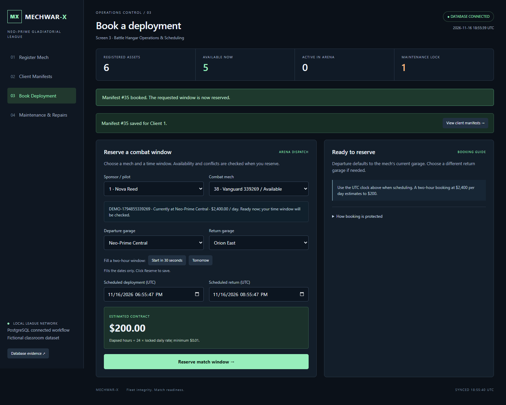

# MechWar-X

A working combat-mech fleet, arena booking and repair management system for the
COP 4703 group project. Four browser screens connect to a real PostgreSQL database.



## Start here, team

- **Run the app:** download the [Windows Run Kit](https://github.com/RelP1234/MechWar-X/releases/latest) from the Releases
  section, extract the entire ZIP, then double-click `Start.cmd`.
- **Understand the demo:** read the [five-minute presentation guide](docs/PRESENTATION_GUIDE.md),
  including the speaking script, click sequence and likely questions.
- **Review the submission:** open the three PDFs below.
- **Review or improve the code:** use the file map below. Everyone can read this
  public repository. Direct edits require collaborator access; otherwise use a fork
  and pull request.

| Submission PDF | Contents |
| --- | --- |
| [SQL implementation](docs/submission/GX_SQL.pdf) | Complete SQL, procedures, constraints and three real SQL screenshots |
| [ERD and relationships](docs/submission/GX_ERD.pdf) | Physical diagram, every relationship and normalization explanation |
| [GUI implementation](docs/submission/GX_GUI.pdf) | Complete implementation code, six screenshots and test results |

**Canvas submission is exactly these three PDFs.** Replace `X` with the confirmed
group number. The source repository, ZIP and rehearsal guide are for team review
and practice. No Canvas submission has been performed. Every member must attend
the classroom demonstration.

## Run locally

### Windows x64: easiest option

1. [Download the Windows Run Kit](https://github.com/RelP1234/MechWar-X/releases/download/v1.0.0/MechWar-X_Windows_Run_Kit.zip).
2. Extract the entire archive to a writable folder. Do not launch from inside it.
3. Double-click `Start.cmd`. The first start may take about a minute.
4. Open <http://127.0.0.1:3080/> if the browser does not open automatically.
5. Double-click `Stop.cmd` when finished; wait five seconds before moving files.

The release kit includes Node.js and PostgreSQL; no separate database installation
or internet access is needed after downloading. Data stays in its local `data/`
folder between launches. Ports 3080 and 55432 must be free. Rehearse on the actual
presentation laptop. If startup fails, inspect `data/server-error.log`.

### Source checkout

Install Node.js 20 or later, open a terminal in this repository, then run:

```sh
npm install
npm start
```

Open <http://127.0.0.1:3080/>. Keep the server running while using the interface.
Windows x64 is the verified classroom environment. Other operating systems are
not certified by the recorded tests. Downloading GitHub's **Code -> Download ZIP**
provides source files, not the portable runtime kit.

**The repository is not a hosted app.** Each teammate runs their own local database.
A `127.0.0.1` link only opens the system on the computer running it; it does not
connect partners to Merrel's machine. All included people and contact details are
fictional demonstration records.

## Four-screen workflow

1. **Register Mech:** validate a unique chassis, required fields and positive
   numerical values. Garage dispatch contacts remain visible. Use **Book this mech**
   to carry the new asset into booking.
2. **Book Deployment:** select the client and return garage. Departure defaults
   to the mech's location. Date shortcuts fill a window; **Reserve** saves it.
3. **Client Manifests:** search by Client ID. Start enables when the countdown ends.
   Complete records actual cost, operating hours and the return garage. Cancel
   releases a booked window while preserving any legitimate repair lock.
4. **Maintenance & Repairs:** report routine or critical incidents. Critical damage
   immediately blocks allocation. **Update repair** loads an incident's saved chief
   and notes; repaired incidents remain available in history.

All displayed and entered times are **UTC**. Client 1 is Nova Reed; Client 2 is Kai
Stone. Client 3 has an expired license for rejection testing. Mech 3 (Longbow)
begins with a critical fault. Full rules and assumptions are in
[Setup and operating rules](docs/SETUP_AND_RULES.md).

## Database design and safeguards

- Eight physical tables, 56 columns and 11 foreign-key relationships.
- Six stored procedures, four trigger functions and four automatic row triggers.
- Overlap prevention uses a database procedure, row locks and an exclusion constraint.
- Cancellation and maintenance changes automatically recalculate inventory status.
- Completing a deployment records hours, billing and garage transfer atomically;
  repeated completion cannot add hours twice.
- Parameterized queries and a restricted application database role protect writes.
- The rate is fixed at booking; two hours at $2,400/day estimates $200.

[View the physical ERD](docs/MechWar-X-ERD.svg) or use the ERD PDF for the full
relationship table and design rationale.

## Verification

The recorded November 16, 2026 baseline passed **36 database integration tests**
and **22 browser workflow checks**. These are local test results, not a grade claim.

- [Database results](docs/testing/test-results.json)
- [Browser results](docs/testing/browser-test-results.json)
- [Actual interface screenshots](docs/screenshots)

With the app running, run `npm test` or double-click `Test.cmd`. The database suite
creates its own temporary database and removes only that test database. It does
not erase rehearsal data. The optional browser harness requires Playwright and
Chrome and creates new fictional records. Run it with `node browser-test.mjs`;
`PLAYWRIGHT_PATH` and `CHROME_PATH` can point to installed tools.

## File map

| File or folder | Purpose |
| --- | --- |
| `schema.sql` | Tables, constraints, views, stored procedures, triggers and grants |
| `seed.sql` | Fictional starter clients, garages, technicians and mechs |
| `bootstrap.sql` | Manual database creation alternative |
| `database.mjs` | Local PostgreSQL initialization and database connections |
| `server.mjs` | HTTP API, input validation and parameterized SQL calls |
| `public/` | Four-screen browser interface |
| `test.mjs` | Database integration tests |
| `browser-test.mjs` | Browser workflow verification |
| `validation.sql`, `application_queries.sql` | Verification and application SQL |
| `export-design.mjs` | Generate the physical ERD from the installed schema |
| `docs/` | PDFs, diagram, screenshots, test evidence and presentation guide |

Local credentials, database contents, dependencies and runtime executables are
excluded from source control. The release kit excludes generated database data
and local credentials too.

## AI disclosure

OpenAI Codex (GPT-6) generated and modified the schema/DDL, SQL procedures and
triggers, connection/bootstrap code, HTTP routes, four GUI screens, validation,
tests, ERD and documentation. Merrel Payne reported instructor permission for this
scope. Group members remain responsible for reviewing, understanding, testing
and rehearsing the project. The primary application file and PDFs also disclose
AI assistance.
